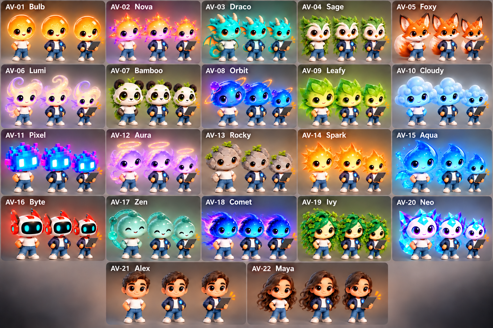

# Avatar

This area contains the PET avatar options and the plan for building the avatar system first. Message/alert is a supported presentation state; the PET may carry a tablet when showing it.

- [22 PET avatar options](AVATAR_OPTIONS.md) lists the proposed visual identities.
- [Avatar Visual Design Brief](DESIGN_BRIEF.md) records the selected collection direction and individual character-form cues.
- [Avatar Development Plan](DEVELOPMENT_PLAN.md) sequences design approval, the all-20 first-release catalogue, the presentation runtime, and later desktop integration.
- [Avatar State Model](STATE_MODEL.md) defines connection/activity states, adapted outfit rules, transitions, accessibility, safe fallbacks, and verification cases.

The collection uses polished, expressive stylized 3D characters with distinct silhouettes, bright individual palettes, and an office-casual look: a minimal T-shirt and jeans, with a casual jacket and shared chest badge when connected. Bulb is the initial default; users can change it later. Avatars are presentation projections and do not own Employee identity, permissions, or agent execution. Office UI, agent behavior, and the 3D office are later integrations.

## Additional human worker options

The catalogue now includes two human office-worker concepts alongside the original 20: Alex and Maya. Both use the same minimal T-shirt-and-jeans base outfit and casual jacket with shared chest badge when connected.

## Bulb reference design

[Bulb reference states](assets/concepts/bulb-reference-states-v1.png) is an initial visual draft showing the T-shirt-and-jeans base outfit, connected jacket and chest badge, and tablet-carrying message/alert presentation.

## Interactive Bulb prototype

[Open the Bulb 3D prototype](prototype/index.html) in a modern browser with internet access. It demonstrates the T-shirt-and-jeans base look, connected jacket and badge, and independent message/alert tablet state. This is an early concept-matched visual preview, not production artwork.

## Bulb model sheet

**Approved as the visual reference direction.** [Bulb character model sheet](assets/concepts/bulb-model-sheet-v1.png) shows base outfit front/side/back views, connected and message/alert looks, facial expressions, and key material details. Approval applies to the visual direction; this remains concept artwork, not production art.

## Concept sheet

The contact sheet is low-fidelity visual exploration for collection review, not approved production artwork. It shows all 22 current concepts in base, connected, and message/alert poses. Every connected pose, including tablet-carrying message/alert poses, shows the dark casual jacket and shared chest badge. Comet now has a clearly separated connected pose with the dark jacket and badge, in addition to its base and tablet poses.

