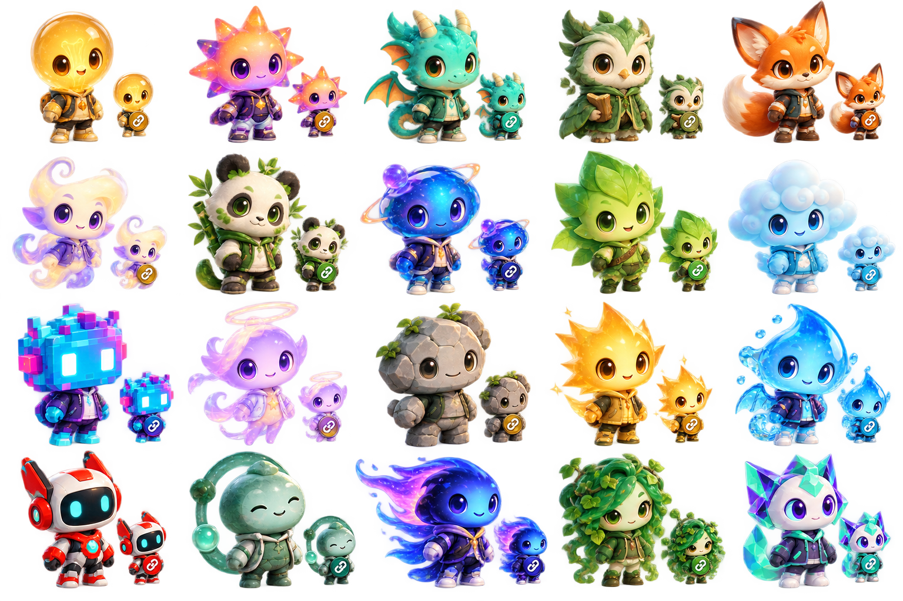

# Avatar

This area contains the PET avatar options and the plan for building the avatar system first.

- [20 PET avatar options](AVATAR_OPTIONS.md) lists the proposed visual identities.
- [Avatar Visual Design Brief](DESIGN_BRIEF.md) records the selected collection direction and individual character-form cues.
- [Avatar Development Plan](DEVELOPMENT_PLAN.md) sequences design approval, the all-20 first-release catalogue, the presentation runtime, and later desktop integration.
- [Avatar State Model](STATE_MODEL.md) defines connection/activity states, adapted outfit rules, transitions, accessibility, safe fallbacks, and verification cases.

The collection direction is playful, expressive stylized 3D chibi characters with distinct silhouettes and bright individual palettes. Bulb is the initial default; users can change it later. Avatars are presentation projections and do not own Employee identity, permissions, or agent execution. Office UI, agent behavior, and the 3D office are later integrations.

## Concept sheet

The contact sheet is low-fidelity visual exploration for collection review, not approved production artwork. The connected-state insets show the adapted outer layer and shared chest badge.

